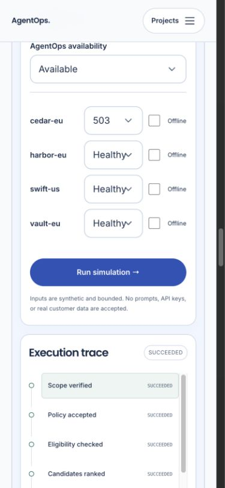

# AgentOps

A policy-first model routing engine with durable execution and usage accounting. It filters candidates before ranking, reserves budget transactionally, and permits retries or fallback only within the original constraints.

Version **0.1.3**. The default application is a self-hostable deterministic demonstration with synthetic data. It executes real application code, makes no paid model calls and changes no customer systems. [Try the public demo](https://portfolio.gappazappa.in/projects/agentops).

## Run locally

Install Docker Engine with Compose v2. Use the Docker context that runs your engine; do not change another application's context or configuration.

```sh
git clone https://github.com/prasanthp01/agentops.git
cd agentops
docker compose up --build -d --wait
```

Open **http://127.0.0.1:8785/projects/agentops**. The default stack publishes only a loopback port. Generated credentials are ignored by Git; keep them private. Configuration helpers preserve existing files. Stop with `docker compose stop`; retain volumes and secrets to resume later. See [troubleshooting](docs/TROUBLESHOOTING.md).



## Try it

Run **Economical route**: `cedar-eu` is selected. Run **Primary outage**: the engine falls back to `harbor-eu`; `swift-us` remains excluded by the EU-only policy. Budget exhaustion returns a refusal. All provider responses, token counts and prices in these scenarios are synthetic.

Change inputs, run again, inspect chronological server events, switch to the technical view and compare results. Recorded results are labelled separately from a new execution.

## How it works

FastAPI provides bounded public and scoped private interfaces. SQLite WAL stores jobs, leases, sessions and a transactional integer-microdollar ledger. Workers filter the catalog, reserve quota, execute a mock provider, validate output and settle usage. Attempt identifiers and fenced leases protect against duplicate accounting and stale workers.

- [Architecture and tradeoffs](architecture.md)
- [API, request formats and examples](docs/API.md)
- [Operations, backup and recovery](operations/runbook.md)
- [Security boundaries and reporting](SECURITY.md)

## Scope and production deployment

The shipped queue executes mock adapters only. Real-provider requests return `LIVE_MODEL_NOT_CONFIGURED`; adding a key does not enable paid inference. The cached-policy client refuses billable calls without central quota authority and signals caller-owned deterministic processing or human review.

For an internet-facing deployment, follow [deployment requirements](docs/DEPLOYMENT_GUIDE.md): configured HTTPS origin, secure cookies, narrow ingress, isolated storage, resource limits, tested backups and monitored health. The default local command is not an internet-facing deployment. Production readiness applies to the documented synthetic scope; live inference and enterprise workloads require separate validation.

## Verify and contribute

Python verification uses Python 3.12 and `uv`. The lockfile pins the resolved dependencies.

```sh
uv sync --frozen --python 3.12
uv run pytest --cov=agentops --cov-fail-under=90
uv run ruff check agentops tests scripts operations
uv run python -m scripts.evaluate
uv run python -m scripts.export_contracts
```

Database tests require disposable databases and refuse ordinary application databases. Never point tests, load tools or recovery drills at a live deployment. The [release report](docs/RELEASE_READINESS.md) records current test results and remaining limits. Hosted CI repeats the relevant checks on pushes and pull requests. See [CONTRIBUTING.md](CONTRIBUTING.md) for the test environment and review process.

## Performance and cost

Use `uv run python -m scripts.benchmark` in an isolated environment and record the revision, hardware, concurrency and duration. Synthetic provider costs and modeled latency are not invoices or live-provider measurements. Keyless runs have zero external model spend; hosting and CPU costs remain separate. No commercial-scale capacity or independent penetration-test claim is made.

## License

MIT for the original implementation. Bundled dependencies and assets retain their own licenses; see [third-party notices](NOTICE.md). No personal CV, portrait, deployment credentials or private customer data is included.
