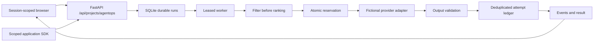

# Architecture

The service is a single-host Python ASGI application. FastAPI serves a buildless HTML/CSS/JS case study and prefixed REST/SSE routes. A fixed-size worker pool claims durable jobs from SQLite. No public execution path performs outbound inference or accepts arbitrary prompt text.

## Components

`contracts.py`: bounded request models, provider catalog, service credentials, run state. Unknown fields are rejected. `catalog.py`: versioned synthetic provider models and nine presets. `engine.py`: deterministic eligibility, ranking, virtual retry time, per-run circuit simulation, fallback and result construction. `store.py`: sessions, rate buckets, durable runs, events, budgets and attempt records. `worker.py`: two threads, periodic cleanup and bounded recovery. `app.py`: ownership, CSRF, credentials, route isolation, result/SSE/poll access and security headers. `client.py`: caller SDK and fail-closed cached-policy decision. `static/`: responsive interface without a frontend build chain or third-party CDN.

## Transaction and recovery invariants

SQLite uses WAL on local disk, foreign keys, short `BEGIN IMMEDIATE` transactions and a busy timeout. It is not a distributed store and must not use a shared network filesystem. Budget accounts contain integer microdollars: `used + reserved <= cap`. Each attempt has a unique `(run_id, model:retry)` identity. A single transaction checks and reserves across all relevant accounts. Settlement releases the ceiling and records the modeled amount once; all attempts, including failures, are retained. App/global budget totals outlive individual run retention.

An operation id is scoped to the authenticated app/session and bound to a canonical request hash. Reusing it with different input fails. A worker holds a lease plus monotonically increasing claim version. Every result, event, reserve and settle operation checks that fence. Cancellation advances the fence and releases only unconsumed mock reservations. A recovered synthetic job can deterministically replay its steps without duplicate events or charges. This does not establish exactly-once guarantees for real providers.

SSE events have transactionally ordered sequence numbers. Reconnect uses Last-Event-ID; polling returns only newer events. Every route checks run ownership. Sessions are high-entropy opaque server-side credentials stored as hashes, with separate CSRF secrets, expiry and secure-cookie production configuration. No run ID alone grants access.

## Time and determinism

Provider latency, retry waits, quality and token prices are fixture values. Retry-After advances a virtual clock rather than sleeping. Stable inputs, fixture/policy versions and seed reproduce semantic decisions and costs. Run IDs, UTC timestamps, measured elapsed time and operation-specific usage IDs naturally differ. They are excluded when testing semantic determinism.

## Scope and operational limits

Maximum 64 active jobs, four per owner, 300 new runs per minute globally and 30 per owner; maximum 2,000 retained runs. Sessions expire after two hours, public runs after one hour, private synthetic runs after 30 days. SSE connections are bounded at four per owner and 64 per process, with a 30-second connection lifetime. Logical jobs have a 60-second age limit; synthetic provider deadlines are separately bounded at 15,000 modeled milliseconds. Admission limits are fixed-window controls, not a claim of DDoS protection.

A full retention pool rejects new work instead of deleting unexpired evidence. At high loads SQLite serializes write-heavy traces; measure a target host before increasing worker counts. The gateway does not share provider-health state across real applications because it has no live provider path. Circuit behavior is a reproducible per-run simulation, not a production circuit service.

## Technical references

Implementation consulted [FastAPI lifespan](https://fastapi.tiangolo.com/advanced/events/), [Pydantic models](https://docs.pydantic.dev/latest/concepts/models/), [SQLite isolation](https://www.sqlite.org/isolation.html), and [Docker Compose production guidance](https://docs.docker.com/compose/how-tos/production/). These references inform mechanisms; verification claims come from this repository's receipts.
